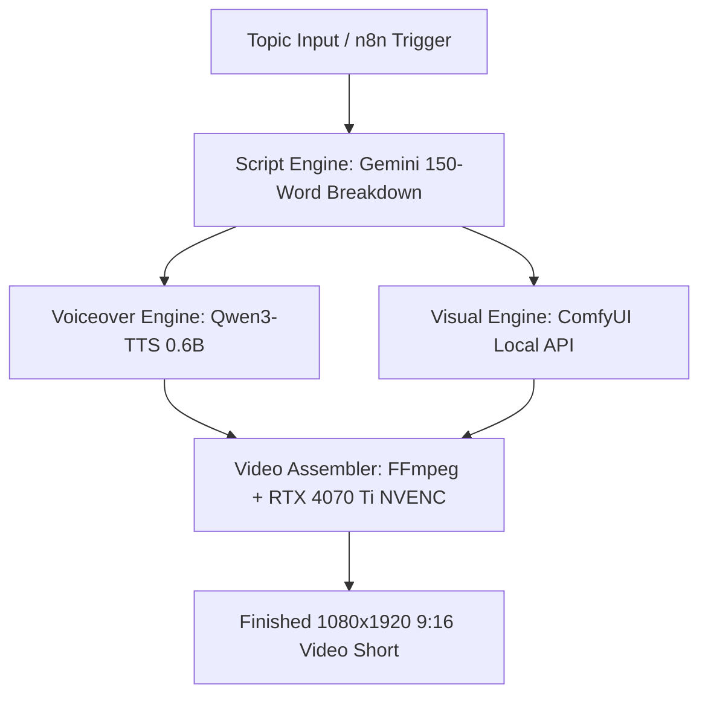

# 🎬 Automated AI Narrative Shorts Factory

An autonomous, end-to-end content production pipeline that creates original 1-minute narrative videos (historical mysteries, psychological breakdowns, sci-fi anomalies) optimized for maximum retention and monetization on TikTok Creator Rewards and YouTube Shorts.

Runs 100% locally on your hardware (**RTX 4070 Ti 12GB**) with **zero recurring API costs** for voiceover and video rendering.

---

## 🏗️ Architecture & Component Flow



1. **Scriptwriter Node (`script_generator.py`)**:
   - Uses Gemini API (`gemini-3.8-flash`) with strict prompt constraints.
   - Outputs an aggressive 3-second pattern-interrupt hook.
   - Enforces a 145-165 spoken word count, strictly calibrating audio length to 60–65 seconds (satisfying TikTok Creator Rewards threshold).
   - Generates 6 to 8 visual scene beats with photorealistic atmospheric prompts.

2. **Voiceover Engine (`tts_engine.py`)**: **Qwen3-TTS 0.6B CustomVoice**, local on the GPU (~2 GB VRAM):
   - 9 speakers: `ryan`, `aiden` (native English), `vivian`, `serena`, `uncle_fu`, `dylan`, `eric` (native Chinese), `ono_anna` (Japanese), `sohee` (Korean). Default `ryan`.
   - Sent as `qwen:<speaker>` or `<speaker>`; unknown ids (e.g. old Kokoro `af_heart`) fall back to `ryan`.
   - **Style instruction (`instruct`)**: e.g. `"whispering suspensefully"`, `"intense curiosity with dramatic pauses"`.
   - ~2.6 spoken words/s; takes ~1.4x the audio length to generate (60 s of voice ~ 85 s).
   - Weights (2.4 GB) download once into `data/narrative_shorts/models/qwen3/` (`HF_HOME`).
   - **Fish Speech 1.5** (alternative model): voices sent as `fish:<name>` go to the `fish-speech` compose service
     (`docker compose --profile fish up -d fish-speech`, keeps ~3-4 GB VRAM loaded; weights are CC-BY-NC-SA 4.0, non-commercial).
     It clones `data/voices/fish/<name>.wav` + `<name>.txt` (transcript); for a Qwen speaker name the clip is recorded with Qwen on first use.
     No style instruction: `instruct` and delivery tones are ignored. URL: `FISH_SPEECH_URL` or `tts.fish_speech.url` in `config.json`.

3. **Visual Engine (`comfy_client.py`)**:
   - Communicates directly with ComfyUI at `http://127.0.0.1:8188` via `/prompt` and `/history`.
   - Generates 1024x1024 anchor frames for each narrative scene beat.

4. **Video Assembler (`assembler.py`)**:
   - Uses **FFmpeg 7.1** with **NVIDIA NVENC hardware acceleration (`h264_nvenc`)**.
   - Applies cinematic **Ken Burns motion dynamics** (cycles between Center Zoom-In, Zoom-Out, Left-to-Right Pan, Right-to-Left Pan).
   - Formats to **1080x1920 (9:16 Vertical Short)** at 24fps.
   - Synchronizes scenes to match the voiceover down to the millisecond.
   - Flags video with `-movflags +faststart` for instant mobile playback.

5. **Local Webhook & Orchestration API (`server.py`)**:
   - High-performance local HTTP server running on `http://127.0.0.1:5050`.
   - Exposes REST endpoints for n8n or any external trigger.

---

## 📁 Directory Framework

```
c:\code\ForgeAi\
├── narrative_factory\
│   ├── config.json              # Central configuration settings (TTS engine, default voices)
│   ├── config.py                # Configuration loader
│   ├── script_generator.py      # Gemini scriptwriter with hook & scene beats
│   ├── tts_engine.py            # Qwen3-TTS synthesizer
│   ├── comfy_client.py          # ComfyUI API client (http://127.0.0.1:8188)
│   ├── assembler.py             # FFmpeg / NVENC Ken Burns 9:16 video stitcher
│   ├── pipeline.py              # Master CLI orchestrator
│   ├── server.py                # Local REST API server (Port 5050)
│   └── README.md
├── workflows\
│   └── n8n\
│       └── narrative-shorts-factory.json  # Import-ready n8n workflow
└── data\
    └── narrative_shorts\
        ├── models\
        │   └── qwen3\           # Cached Qwen3-TTS weights (HF_HOME)
        ├── jobs\                # Timestamped job folders with scripts, audio, frames
        └── exports\             # Finished .mp4 videos ready for upload
```

---

## 🚀 Quickstart & Usage

### 1. Run Complete Pipeline via CLI
Generate an entire 1-minute narrative video:
```powershell
docker exec forgeai-narrative python pipeline.py --topic "The Dyatlov Pass Incident" --voice ryan
```
*(Use `--skip-images` if ComfyUI is not currently launched to test with fast placeholder frames).*

### 2. Run the Webhook Server (for n8n & the dashboard)
Runs as the `narrative-factory` service in the root `docker-compose.yml` (port 5050):
```powershell
docker compose up -d narrative-factory
```

Available Endpoints:
- `GET  http://127.0.0.1:5050/status` — Health check, ComfyUI/NVENC status and the voice list
- `POST http://127.0.0.1:5050/api/run-pipeline` — Trigger end-to-end video creation (topic or custom `script`, `voice`, `instruct`)
- `POST http://127.0.0.1:5050/api/tts-timed` — Studio: sentence-paced voice-over with scene spans, word timings, and optional `instruct`
- `POST http://127.0.0.1:5050/api/image` — Studio: one portrait ComfyUI image
- `POST http://127.0.0.1:5050/api/edit` — Studio: cut scenes to the voice-over and burn in captions

### 3. Dependencies & Qwen3-TTS Install
- **Container Build (`uv pip`)**:
  The Docker image installs `uv` from Astral and uses `uv pip` to install CUDA `torch`/`torchaudio` (cu128 index) and `qwen-tts`. When modifying `requirements.txt` or `Dockerfile`:
  ```powershell
  docker compose build narrative-factory
  ```
- **Local Host Environment (`uv pip`)**:
  To develop and run Python scripts on the host using `uv`:
  ```powershell
  uv venv --python 3.12
  uv pip install -r narrative_factory/requirements.txt
  ```

### 4. Import n8n Workflow
1. Open your local n8n instance (`http://localhost:5678`).
2. Go to **Workflows** > **Import from File**.
3. Select `c:\code\ForgeAi\workflows\n8n\narrative-shorts-factory.json`.
4. The workflow is pre-configured with webhook triggers, data mapping, and direct calls to `host.docker.internal:5050` and `host.docker.internal:8188`.
